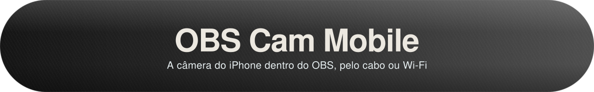
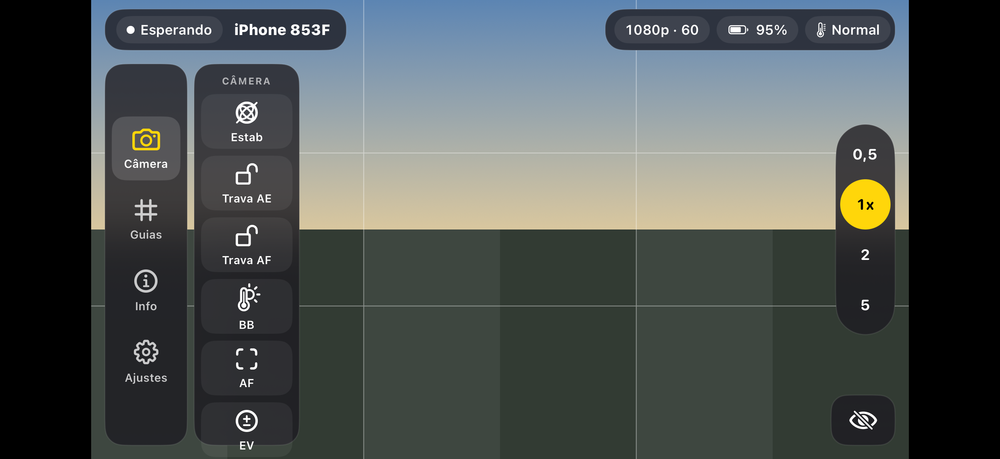
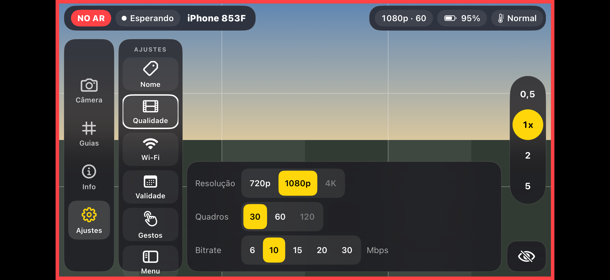

<!-- readme-padrao:header -->
<div align="center">
  
</div>

<div align="center">
  
</div>

<div align="center">

  <p><strong>Liga o iPhone no cabo, abre o app e a imagem já está no OBS.</strong></p>

  <p>
    
    
    
    
    
    
    <a href="LICENSE"></a>
  </p>

  <p>
    <a href="#por-que-existe">Por que existe</a> •
    <a href="#o-que-faz">O que faz</a> •
    <a href="#como-funciona">Como funciona</a> •
    <a href="#requisitos">Requisitos</a> •
    <a href="#como-usar">Como usar</a> •
    <a href="#stack">Stack</a> •
    <a href="#rodar-local">Rodar local</a> •
    <a href="#documentação">Documentação</a> •
    <a href="#licença">Licença</a>
  </p>
</div>

<br>

<div align="center">
  
</div>

## O que é

```yaml
produto:   app de câmera para iPhone + extensão do OBS que recebe o vídeo pelo cabo ou Wi-Fi
quem_usa:  quem opera transmissões ao vivo com OBS no Windows ou no Mac
estado:    1.0.5, em uso interno
```

<!-- /readme-padrao:header -->

## Por que existe

Quem transmite com OBS e quer usar o iPhone como câmera costuma cair em app de terceiro: marca d'água, assinatura mensal, atraso alto pelo Wi-Fi ou a câmera sumindo no meio da live. O OBS Cam Mobile foi escrito do zero para isso não acontecer: o vídeo vai pelo cabo USB com atraso de câmera de verdade, a extensão reconecta sozinha e segura o último quadro enquanto isso, e o app instala sem conta paga da Apple.

## O que faz

- **iPhone como câmera do OBS.** Uma fonte "OBS Cam Mobile Extension" por iPhone. Ligou quatro iPhones, aparecem quatro, cada um com a sua configuração.
- **Cabo primeiro, Wi-Fi de reserva.** Escolha "iPhone 15 Pro Max · Cabo" ou "· Wi-Fi". Se o computador derrubar o cabo, a fonte segue pelo Wi-Fi e volta ao cabo sozinha.
- **Tela de câmera de verdade.** Prévia para enquadrar, lentes 0,5 / 1 / 2 / 5, foco e exposição manuais, ISO e obturador, balanço de branco, estabilização, travas AE e AF, grade, cruz central e nível.
- **Qualidade no celular ou no OBS.** 720p, 1080p ou 4K, 30, 60 ou 120 quadros, bitrate de 6 a 30 Mbps. O OBS pode fixar o formato ou o bitrate, e só aquele campo fica travado no celular.
- **NO AR.** Quando a cena com o iPhone entra no ar no OBS, o celular mostra a borda e o selo vermelhos.
- **Modo limpo.** Some toda a interface e ficam só grade, cruz e nível. As guias nunca vão para o vídeo enviado.
- **Controle pelo OBS.** O painel OBS Cam Mobile troca lente, EV, travas AE, AF e BB e a qualidade de cada iPhone, e o botão Testar mede o atraso e diz se o cabo está ok. As propriedades da fonte mostram o status ao vivo (canal, formato, atraso, fps, bitrate, bateria, temperatura).
- **Fonte que se ajeita sozinha.** Girou o iPhone ou trocou a resolução: o item da cena fica no mesmo lugar. Dá para escolher o que aparece quando o iPhone cai (último quadro, tela preta ou uma imagem), o modo de recepção (menor atraso ou mais estável) e a decodificação (automática, hardware ou software).
- **Validade à vista.** O app mostra quantos dias faltam para a assinatura vencer e tem o atalho "Dias para vencer" para o app Atalhos.

<div align="center">
  
</div>

## Como funciona

```text
 iPhone (OBS Cam Mobile)                     Computador (OBS + extensão)
 ┌──────────────────────────┐                ┌──────────────────────────────┐
 │ câmera → H.264 realtime  │  cabo USB      │ usbmuxd / Apple Mobile       │
 │ (VideoToolbox, sem       │ ─────────────▶ │ Device Service → porta 4848  │
 │  quadros B, Annex B)     │  ou Wi-Fi      │ FFmpeg decodifica em baixo   │
 │ servidor TCP :4848       │ ─────────────▶ │ atraso → fonte assíncrona    │
 │ anúncio _fmcam._tcp      │  (Bonjour)     │ painel com todos os iPhones  │
 └──────────────────────────┘                └──────────────────────────────┘
```

- **Protocolo próprio** (`docs/PROTOCOLO.md`): uma linha de JSON de cada lado para combinar formato e lente, depois pacotes binários de configuração, quadro, status e comando. O relógio dos dois lados é sincronizado por ping, e é assim que o atraso é medido.
- **Fila curta de propósito.** O iPhone nunca acumula vídeo velho: no máximo 1 segundo na fila. Se a rede engasgar, ele descarta até o próximo quadro-chave.
- **Um computador por iPhone.** O iPhone atende uma conexão por vez. Outra fonte tentando o mesmo aparelho vê "iPhone ocupado".
- **Medido no aparelho:** cerca de 45 ms do iPhone até o computador pelo cabo em 1080p, e 10 minutos seguidos a 60 quadros sem nenhum quadro perdido. Em 4K (2160p30) no iPhone 15 Pro Max, cerca de 80 ms até o quadro entregue ao OBS e cerca de 90 ms até o canvas desenhado (24/11/2026, `docs/varreduras/varredura-1.md`).

## Requisitos

| Onde | O que precisa |
|---|---|
| iPhone | iOS 16 ou mais novo, com câmera traseira. Testado no iPhone 15 Pro Max |
| iPhone | **SideStore** e **LocalDevVPN** para instalar e renovar o app com Apple ID grátis |
| Computador | **OBS Studio 33.0.1**, 64 bits (Windows 10 ou 11 x64, ou macOS) |
| Windows | Serviço USB da Apple (o instalador já inclui) |
| Rede | Para o Wi-Fi: iPhone e computador na mesma rede |

## Como usar

**1. Instalar no iPhone (uma vez)**

1. No iPhone, instale o **LocalDevVPN** pela App Store e toque em Conectar.
2. Com o iPhone no cabo, rode o [iloader](https://iloader.app) no computador, entre com o Apple ID e escolha **SideStore (Stable)**.
3. No iPhone: Ajustes > Geral > VPN e Gerenciamento de Dispositivos > **Confiar**, e Ajustes > Privacidade e Segurança > **Modo de desenvolvedor**.
4. No SideStore: **My Apps** > **+** > escolha o `OBSCamMobile.ipa`.

O Apple ID grátis aceita 3 apps assinados por aparelho. A assinatura vale 7 dias e o SideStore renova sozinho com Wi-Fi e LocalDevVPN ligados.

**2. Instalar no computador (uma vez)**

- **Windows:** rode o `OBSCamMobile-Extension-Setup.exe` com o OBS fechado. Copie o instalador por pendrive ou pasta da rede para o Windows não mostrar aviso. Se aparecer "O Windows protegeu o computador": **Mais informações > Executar assim mesmo**.
- **Mac:** `cmake --build build-final --target instalar-obs` (veja [Rodar local](#rodar-local)).

**3. Transmitir**

1. Ligue o iPhone no cabo e abra o **OBS Cam Mobile**. Deixe o app aberto e na frente.
2. No OBS: Fontes > **+** > **OBS Cam Mobile Extension** > escolha **iPhone ... · Cabo**.
3. O painel **OBS Cam Mobile** (menu Docks) mostra todos os iPhones ligados, com bateria, temperatura e formato.

O passo a passo para quem opera está em [`docs/GUIA-OPERADOR.md`](docs/GUIA-OPERADOR.md).

## Stack

| Camada | O que usa |
|---|---|
| App do iPhone | Swift e SwiftUI, AVFoundation, VideoToolbox, Network.framework, App Intents |
| Núcleo de transporte | C++17, cliente usbmuxd próprio, TCP, FFmpeg (libavcodec) |
| Extensão do OBS | C++17 sobre libobs 33.0.1, painel em Qt 6 |
| Windows | Compilado no Mac por compilação cruzada (clang-cl, lld, xwin), instalador NSIS |
| Testes | ctest com iPhone falso, usbmuxd falso e OBS sem tela, XCTest no simulador |

## Rodar local

Precisa de Mac com Xcode, Homebrew e o OBS 33.0.1 em `/Applications`.

```bash
brew install cmake ninja pkg-config ffmpeg xcodegen

# núcleo, ferramentas e extensão
cmake -S . -B build-final -G Ninja
cmake --build build-final
cmake --build build-final --target instalar-obs   # copia a extensão para o OBS do Mac

# app do iPhone
cd ios && xcodegen generate && open FMCam.xcodeproj

# critério de pronto: testes rápidos, ou tudo (ponta a ponta + iOS no simulador)
sh .claude/verificar.sh
COMPLETO=1 sh .claude/verificar.sh

# Windows: DLL e instalador
sh obs-plugin/scripts/compilar-windows.sh
sh obs-plugin/scripts/montar-instalador-windows.sh
```

O instalador do Windows embute o serviço USB da Apple, tirado do instalador oficial do iTunes. Esse arquivo fica fora do git e o instalador gerado é só para uso interno.

## Documentação

| Doc | O que é |
|---|---|
| [`docs/GUIA-OPERADOR.md`](docs/GUIA-OPERADOR.md) | Guia de uma página para quem opera a transmissão |
| [`docs/PROTOCOLO.md`](docs/PROTOCOLO.md) | Protocolo entre o iPhone e a extensão |
| [`docs/HANDOFF.md`](docs/HANDOFF.md) | Estado do projeto, números medidos e armadilhas |
| [`docs/PLANO.md`](docs/PLANO.md) | Plano por marcos |
| [`ios/LEIA.md`](ios/LEIA.md) | Como compilar e instalar o app |
| [`obs-plugin/LEIA.md`](obs-plugin/LEIA.md) | Como compilar e instalar a extensão |

## Licença

O código deste repositório está sob a [licença MIT](LICENSE). Três pontos à parte:

- **Extensão compilada:** ela usa o libobs, que é GPLv2. O binário distribuído junto com ele segue as condições da GPL.
- **Serviço USB da Apple:** não faz parte deste projeto, não está no repositório e não é coberto pela MIT.
- **Marcas:** OBS Studio é marca do OBS Project e iPhone é marca da Apple. Este projeto não tem ligação com eles.

<!-- readme-padrao:footer -->
<br>

---

<div align="center">
  <p><strong>Feito por <a href="https://github.com/leonardorejani">Leonardo Rejani</a></strong></p>
  <a href="https://github.com/leonardorejani">
    
  </a>
  <a href="https://instagram.com/leonardorejani">
    
  </a>
</div>

<br>

<div align="center">
  
</div>
<!-- /readme-padrao:footer -->
